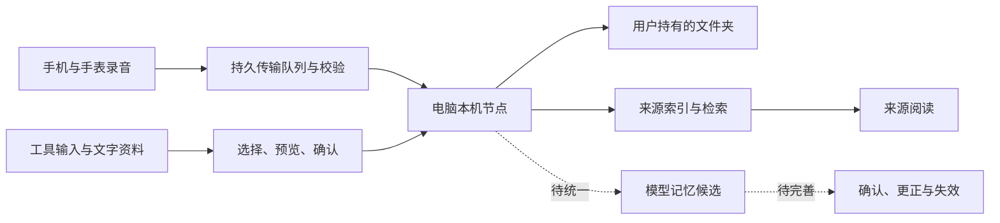

# 架构与当前能力

迹库以用户自己的文件夹为中心。原生应用提供采集、导入、检索与整理，本机节点维护来源、索引、任务和文件版本。



## 模块

| 目录 | 职责 |
| --- | --- |
| `Apple/Phone/`、`Apple/Watch/` | 采集、回放、恢复与传输入口 |
| `Apple/Mac/` | 本机节点生命周期、资料导入、阅读和设置 |
| `Apple/Design/`、`Apple/Networking/` | 共用视觉、语言、连接和资料界面 |
| `Sources/VoiceMemoryCore/` | 稳定录音编号、导入导出、接收校验和持久传输日志 |
| `node/` | 本机接口、文件与索引、来源扫描、文字分析和任务恢复 |
| `integrations/lifto-library/` | 可撤销、有范围的外部只读客户端与接口描述 |

## 资料如何进入

- 录音经校验写入节点；接收回执只代表原音已接收。真实语音识别尚未接入。
- 本地工具支持 Codex（编程助手）当前与归档会话的 `.jsonl`、`.jsonl.zst`，以及 Claude Code（编程助手）的已适配会话格式。清单分批处理，支持暂停和中断恢复，跳过、失败和不完整覆盖应显示给用户。
- 文字资料支持 UTF-8（统一编码）的 `.md`、`.markdown`、`.txt`、`.text`；每份上限 2 MB（兆字节），每批最多 100 份且内容合计不超过 12 MB（兆字节）。原文件不移动，变化另存版本。
- 聊天导入读取用户导出的 JSON（结构化文本）或 ZIP（压缩包），保留发言角色与来源；助手文本不等于个人事实。

## 文件与索引

```text
个人资料夹/
├── transcripts/      # 录音文字
├── notes/            # 笔记与导入的聊天笔记
├── sources/          # 归集的本人工具输入
├── documents/        # 导入的可读资料文字
├── daily/            # 每日来源草稿
├── analysis/         # 明确启用后产生的文字分析
├── memory.md         # 已确认记忆
├── memory-inbox.md   # 候选记忆
├── prompts/          # 整理规则
├── .history/         # 历史版本
└── .generated/       # 与人工修改冲突的新版本
```

节点数据目录另存原音、数据库、队列与连接口令。资料文件和内部索引职责不同；便携文字导出不包含原音与凭证，也不是自动恢复格式。扫描来源的删减不会自动删除已归档资料。

## 记忆与模型的真实状态

当前对话返回资料检索结果和引用。每日文字分析已有兼容接口适配与失败保护，但真实模型质量尚未验收。候选记忆目前仍引用录音编号，文档与工具输入尚未统一到候选生成。

下一步需要统一来源类型、内容版本、原文证据和时间，支持候选、确认、冲突、更正与失效，见[迭代清单](../ROADMAP.md)。统计条数、检索片段或一次摘要都不能直接作为已完成的个人记忆。

## 同步与读取边界

资料夹交换和电脑直连都有持久队列、内容校验与接收回执。真实云账号、异地及后台时机仍需专项验收；苹果专用云端容器与通用网络文件适配尚未实现。

外部只读接口只返回明确授予范围的文字。原有授权不自动包含新增的工具输入与文档。完整描述见[接口约定](../integrations/lifto-library/references/api.md)。
