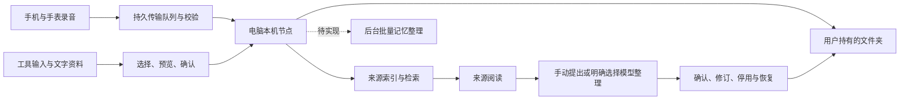

# 架构与当前能力

迹库以用户自己的文件夹为中心。原生应用提供采集、导入、检索与整理，本机节点维护来源、索引、任务和文件版本。



## 模块

| 目录 | 职责 |
| --- | --- |
| `Apple/Phone/`、`Apple/Watch/` | 采集、回放、恢复与传输入口 |
| `Apple/Mac/` | 本机节点生命周期、资料导入、阅读和设置 |
| `Apple/Design/`、`Apple/Networking/` | 共用视觉、语言、连接和资料界面 |
| `Sources/VoiceMemoryCore/` | 稳定录音编号、导入导出、接收校验和持久传输日志 |
| `node/` | 本机接口、文件与索引、来源扫描、文字分析和任务恢复 |
| `integrations/lifto-library/` | 可撤销、有范围的外部只读客户端与接口描述 |

## 资料如何进入

- 录音经校验写入节点；接收回执只代表原音已接收。用户在电脑配置独立语音服务后，可逐条启动转写，或明确开启新接收录音的自动转写。
- 本地工具支持 Codex（编程助手）当前与归档会话的 `.jsonl`、`.jsonl.zst`，以及 Claude Code（编程助手）的已适配会话格式。清单分批处理，支持暂停和中断恢复，跳过、失败和不完整覆盖应显示给用户。
- 文字资料支持 UTF-8（统一编码）的 `.md`、`.markdown`、`.txt`、`.text`；每份上限 2 MB（兆字节），每批最多 100 份且内容合计不超过 12 MB（兆字节）。原文件不移动，变化另存版本。
- 聊天导入读取用户导出的 JSON（结构化文本）或 ZIP（压缩包），保留发言角色与来源；助手文本不等于个人事实。

## 文件与索引

```text
个人资料夹/
├── transcripts/      # 录音文字
├── notes/            # 笔记与导入的聊天笔记
├── sources/          # 归集的本人工具输入
├── documents/        # 导入的可读资料文字
├── daily/            # 每日来源草稿
├── analysis/         # 明确启用后产生的文字分析
├── memory.md         # 已确认记忆
├── memory-inbox.md   # 候选记忆
├── memory-inactive.md # 停用记忆
├── memory-rejected.md # 忽略的建议
├── memories/         # 提出时的依据与逐次修订历史
├── prompts/          # 整理规则
├── .history/         # 历史版本
└── .generated/       # 与人工修改冲突的新版本
```

节点数据目录另存原音、数据库、队列与连接口令。资料文件和内部索引职责不同；便携文字导出不包含原音与凭证，也不是自动恢复格式。扫描来源的删减不会自动删除已归档资料。

## 记忆与模型的真实状态

当前对话返回资料检索结果和引用。每日文字分析已有兼容接口适配与失败保护，但真实模型质量尚未验收。用户可以从录音文字、笔记、本地工具输入与导入文档手动提出记忆建议；保存原文片段、类型、编号、文字版本、位置与提出时间，确认后进入长期记忆。

记忆支持修订、停用、恢复和历史。来源改变后仍展示提出时的片段，并提示当前原文变化；来源不可读取时不丢弃已保存依据。停用记忆不进入新的检索，既有对话保持历史结果。待确认建议不会超时自动确认；文档片段也不会自动被认定为本人事实。

新增候选可提交 `evidence`，每条包含 `kind`、`id`、`contentVersion` 和连续 `quote`；每次最多 16 条来源、每段最多 4000 字符。写入前核对当前文字版本与片段位置。修订接口通过 `memoryRevision` 检测并发修改，可传 `requestID` 避免重试重复创建条目或历史。原有 `sources` 录音编号接口保留。旧记忆没有当时的原文版本时明确标记，不用迁移时的最新文字冒充历史依据。

记忆文件与 `memories/<id>.json` 一起导出，保留相对文件引用及历史；人工修改发生冲突时另存，不覆盖。外部仅获记忆读取权限时，仍只返回已确认的记忆文字，不顺带开放原文片段、历史或其他来源权限。

单份资料的模型整理位于 `node/memory_extraction.py`。电脑与手机均可从原文进入“提出记忆建议→模型整理”，先查看范围与服务地址，再明确发送。当前支持上述四类来源，每份最多 32000 字符，超限拒绝并保留手动入口，不静默截断。配置文字模型不等于开启后台外发；没有批量自动整理计划。

`GET /v1/memory-extractions/<kind>/<id>?version=<contentVersion>` 读取状态；`POST` 必须包含当前版本、`sendToModel: true` 以及预览的 `model` 和 `endpoint`。服务或原文版本变化会阻止发送。只读接入凭证无权调用任务接口。模型输出最多 8 条建议，每条必须自报本人明确陈述，并带原文中唯一可定位的连续引用；整批校验后，建议、证据、模型标记与任务结果在一个事务中保存。模型的归属标记和逐字引用只能约束格式及溯源，无法证明语义或归属正确，仍需用户审阅。

来源和内容版本标识同一个任务。重复打开使用已有结果；中断后需明确重试，不在重启时自动发送。已存建议的文件写入失败只重试导出，保留人工编辑。同一版本的已完成任务不重新请求；网络超时后的重试仍可能造成服务端重复计费，不能承诺远端请求去重。原文或规则在请求中变化时拒绝旧结果。没有建议也是正常完成状态，不生成占位记忆。

后台批量提取、大资料分段、主体归属的真实判定质量、矛盾记忆关系仍待完成，见[迭代清单](../ROADMAP.md)。合成接口与界面闭环不能称作真实模型质量已经通过。

## 同步与读取边界

资料夹交换和电脑直连都有持久队列、内容校验与接收回执。真实云账号、异地及后台时机仍需专项验收；苹果专用云端容器与通用网络文件适配尚未实现。

外部只读接口只返回明确授予范围的文字。原有授权不自动包含新增的工具输入与文档。完整描述见[接口约定](../integrations/lifto-library/references/api.md)。

## 语音转写任务

`node/transcription.py` 通过兼容的 `POST /audio/transcriptions` 发送音频；服务地址必须加密传输，禁止跟随重定向。语音密钥与文字模型分开保存在电脑钥匙串，交给本机进程后仅驻留内存，不写入队列、原文或日志。默认不自动外发；保存配置不等于真实服务验证成功。

`node/speech_audio.py` 只接受本应用的 16 kHz（千赫兹）、单声道、16 位有符号 PCM（脉冲编码调制）CAF（苹果音频格式），将样本无损封装成 WAV（通用音频格式）。每段至多 10 分钟、约 19.2 MB（兆字节），优先在尾部 5 秒的低音量位置分段，完整覆盖所有样本且不重叠。分段不等于说话者识别，也不保证没有句子切断，须用真实长录音验收。

任务按录音编号去重，保存音频校验值、已选服务指纹、片段边界及已完成文字。进程重启后等待应用重新提供密钥，再恢复未完成片段。网络与限流失败最多尝试三次，间隔 30 秒、120 秒；鉴权、格式和空结果失败须人工处理。已完成片段不重复发送；请求超时但上游实际已处理的情况可能再次计费，不能宣称网络上的严格只执行一次。

服务变更会停住旧任务，防止静默转发到另一个提供者。没有已完成片段时可明确点击继续，使用修正后的配置；有部分结果时须恢复原服务继续，当前不混合不同模型结果。暂停、关闭自动处理或移除密钥阻止后续片段发送，已在途的一段可能仍完成。

完整结果写入 `transcripts/<id>.md`，正文在前、来源与录音时间在后。机器文字明确标为待校对，不自动写入已确认记忆。人工改动（包括主动保存的空文字）会保留，转写结果另存，电脑与手机可只读查看。文件写入失败时保留已完成片段，重试无需重新调用语音服务。自动开关只覆盖开启后新接收的录音，历史录音需逐条选择。

开发验证使用本机加密测试服务与合成语音，已走过界面、请求、文件、失败和恢复路径。真实厂商识别质量、长会议、多人归属和异地云同步尚未验收。接口与音频依据分别见 [OpenAI（开放人工智能公司）转写文档](https://developers.openai.com/api/docs/guides/speech-to-text)及 [Apple（苹果公司）音频格式规范](https://developer.apple.com/library/archive/documentation/MusicAudio/Reference/CAFSpec/CAF_spec/CAF_spec.html)。
