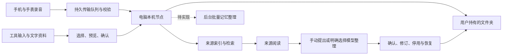

# 架构与当前能力

迹库以用户自己的文件夹为中心。原生应用提供采集、导入、检索与整理，本机节点维护来源、索引、任务和文件版本。



## 模块

| 目录 | 职责 |
| --- | --- |
| `Apple/Phone/`、`Apple/Watch/` | 采集、回放、恢复与传输入口 |
| `Apple/Mac/` | 本机节点生命周期、资料导入、阅读和设置 |
| `Apple/Design/`、`Apple/Networking/` | 共用视觉、语言、连接和资料界面 |
| `Sources/VoiceMemoryCore/` | 稳定录音编号、导入导出、接收校验和持久传输日志 |
| `node/` | 本机接口、文件与索引、来源扫描、文字分析和任务恢复 |
| `integrations/lifto-library/` | 可撤销、有范围的外部只读客户端与接口描述 |

## 资料如何进入

- 录音经校验写入节点；接收回执只代表原音已接收。用户在电脑配置独立语音服务后，可逐条启动转写，或明确开启新接收录音的自动转写。
- 本地工具支持 Codex（编程助手）当前与归档会话的 `.jsonl`、`.jsonl.zst`，以及 Claude Code（编程助手）的已适配会话格式。清单分批处理，支持暂停和中断恢复，跳过、失败和不完整覆盖应显示给用户。
- 文字资料支持 UTF-8（统一编码）的 `.md`、`.markdown`、`.txt`、`.text`，以及 PDF（便携文档）中的已有文字和 DOCX（办公文档）中的结构化文字；每份上限 2 MB（兆字节），每批最多 100 份。节点原始内容合计上限为 12 MB（兆字节），电脑按 10 MB（兆字节）读取预算预留传输编码空间，未读取文件逐份说明。原文件不移动，变化另存版本。
- 聊天导入读取用户导出的 JSON（结构化文本）或 ZIP（压缩包），保留发言角色与来源；助手文本不等于个人事实。

PDF（便携文档）单份最多 200 页、提取文字最多 2 MB（兆字节）。电脑使用独立的系统解析工具，其他支持的类 Unix（操作系统）节点使用固定 `pypdf`；进程不调用图片文字识别、外部解码器或模型，不执行文档动作。父进程限制单份约 10 秒、每批解析约 40 秒，并每 0.1 秒采样内存，超过 384 MB（兆字节）终止；这是采样终止阈值，不是硬性峰值内存保证，也不等于操作系统安全沙盒。子进程还限制计算时间与输出文件大小，父管道关闭时退出。解析失败、加密、超限和无文字分别显示，不把未提取的页当成已读取。

DOCX（办公文档）使用独立的标准库解析子进程，共用上述时间、内存采样和取消监督；父进程退出时子进程退出，并限制计算时间及输出大小。按包内关系定位正文，提取正文、单元格、页眉页脚、脚注尾注及批注，保留分区和提取顺序。输入最多 2 MB（兆字节），压缩展开合计最多 32 MB（兆字节）、单份 XML（可扩展标记语言）最多 8 MB（兆字节），并限制条目、节点、深度、文字和段落数量。拒绝加密、宏主格式、实体定义、危险压缩路径及符号链接；不执行域、不访问外链、不解析图片、文本框、嵌入对象和公式。修订保留插入内容并跳过删除或移出内容；未识别的结构、隐藏文字、未引用附注等在预览中提示。表格坐标表示提取时的行与单元格顺序，不能当成合并后的版式；样式及自动编号未还原，需对照原件。

`POST /v1/documents/prepare` 创建有请求编号的本机解析任务，`GET /v1/documents/<id>/preparation` 读取状态。任务与选择内容绑定，重复请求不重新处理；准备过程中可取消。准备好的预览可在重启后继续确认，未完成解析显示中断并要求重新选择原件；不会自动重新解析。旧预览、确认和取消接口继续可用，均要求设备口令与回环连接，不扩大外部读取范围。

确认后将提取文字写入 `documents/<id>.md`，保留原文件散列校验值、文件页号或提取段落、覆盖提示、解析器和文字版本。位置以归档文字的字符标量计算，人工编辑后失效，阅读器会保留旧引用并说明来源变化。原始 PDF（便携文档）和 DOCX（办公文档）仍在选择位置；导入时可通过 `retainOriginal` 明确保留原字节到 `originals/documents/<id>.<format>`，默认关闭。预览逐文件列出副本，提取文字中发现常见凭证时不保留原件；该过滤不保证识别文件全部敏感内容。重复导入可为原有资料补存副本，不改原文、编号及引用位置。副本按原始散列校验，文件已有不同内容时拒绝覆盖，使用目录描述符和无覆盖发布保护文件链接与并发变更。`GET /v1/documents` 声明副本支持能力，旧节点不会显示可用的保留选项；`GET /v1/documents/<id>/original` 只接受回环连接与设备口令，外部只读凭证不能取得二进制。电脑原文阅读页显示状态并可校验后另存，手机只显示状态；副本改变时明确提示并可重新核对。便携文字导出不包含文档二进制，副本随资料库备份保存。文档列表、检索结果与原文读取共享 `documentRevision`，通过来源位置映射区分最近导入与较早版本，并显示导入时间与归档编号；同名不同位置不推断版本关系。历史检索保存当时的版本状态，界面明确标注“检索时”；旧历史缺少此信息则显示未记录，不补写成当前状态。核对原文会读取该归档的当前状态，不自动切换到另一份导入文件；回答预览再次列出所选归档。更正资料性质也会另存版本。提取顺序、表格和说话人归属仍须对照原件，导入不自动发给模型或确认记忆。

电脑的“扫描详情”按会话文件列出读取进度、末条记录未完整、不可读，以及过大、解析失败、无有效时间等跳过原因。默认只看待处理或有跳过的文件，也可查看全部已登记文件；读取完成不等于每条记录都已归档。旧扫描没有记录细分原因时明确显示未知，不补造诊断。

`local_source_issues` 保存来源编号、相对路径、跳过原因、从零开始的字节位置与从一开始的行号，不保存异常正文。压缩会话按解压后内容定位。每轮最多新增 1,000 条诊断，达到上限保留检查点供后续批次继续，避免截断后的记录永远无法读到；诊断随扫描检查点提交，取消预览或读取范围变更不发布。单文件重查仅替换该文件的位置记录，移走文件时清理诊断与检查点，已归档输入不删。旧检查点没有行号时返回空值，旧跳过数没有位置时单列缺失数量，须重查才能补齐。

`GET /v1/local-sources/<id>/file-issues` 只接受本机设备口令，读取已有扫描元数据，不重新读源文件；外部只读凭证不能访问。以已登记的相对路径选择文件，每页最多 80 条，字节游标绑定保存的扫描状态；状态变化返回 409，客户端保留已读内容、固定显示失败原因并要求刷新，不混合新旧分页。

`GET /v1/local-sources/<id>/files` 返回有上限、可翻页的诊断，不包含原文。`POST /v1/local-sources/<id>/retry-file` 接收已有清单中的相对 `path` 与 `stateVersion`，只检查所选文件；已读完的文件从头复核，未读完的文件从保存位置继续，沿用每批读取上限。其他文件的进度保持不变，稳定输入编号继续去重，人工编辑冲突另存。提交前再次验证已读取的字节，过期状态、文件移走、越界和正在运行的历史导入会阻止操作。来源文件始终只读；应用不会修补损坏原文、猜测日期或提高限制来强行读取。两个接口均要求本机连接口令与回环连接，不扩大外部只读授权。

未写完的最后一条记录保留读取位置，不计为损坏或已归档；仅剩这类记录时任务显示等待来源写完。开启自动归档后，来源补全会在后续检查恢复；关闭时由用户重新检查。

全量检查发现来源文件已移走时，仅移除过期扫描检查点，避免它在详情或后续单文件重试中重新计数；已归档输入、来源路径与记忆依据仍保留。源文件恢复后重新读取，继续按稳定编号去重。

## 文件与索引

```text
个人资料夹/
├── transcripts/      # 录音文字
├── notes/            # 笔记与导入的聊天笔记
├── sources/          # 归集的本人工具输入
├── documents/        # 导入的可读资料文字
├── originals/documents/ # 明确保留的办公文档原件副本
├── daily/            # 每日来源草稿
├── analysis/         # 明确启用后产生的文字分析
├── memory.md         # 已确认记忆
├── memory-inbox.md   # 候选记忆
├── memory-inactive.md # 停用记忆
├── memory-rejected.md # 忽略的建议
├── memories/         # 提出时的依据与逐次修订历史
├── prompts/          # 整理规则
├── .history/         # 历史版本
└── .generated/       # 与人工修改冲突的新版本
```

节点数据目录另存原音、数据库、队列与连接口令。资料文件和内部索引职责不同；便携文字导出不包含原音与凭证，也不是自动恢复格式。扫描来源的删减不会自动删除已归档资料。

## 记忆与模型的真实状态

### 基于所选资料回答

对话先在本机检索。用户可选择这轮结果中最多 8 个片段，每段最多 1400 个原文字符；核对文字、版本、位置与服务后，再明确发送当前问题和所选片段。完整来源、其他结果与历史问题不会自动加入请求。旧检索缺少可靠位置时须重新查询，不通过搜索相同文字补造位置。

`node/answers.py` 使用独立的 `answer` 模型配置；每日分析、记忆整理的配置不会自动成为回答授权。`GET|POST /v1/answer-session` 仅接受本机设备配置，密钥只驻留内存。`POST /v1/conversations/<id>/turns/<id>/answer-preview` 返回待发送范围，`GET|POST` 同路径的 `answer` 读取状态或在明确发送后启动。接口沿用设备口令，外部只读凭证不能生成回答；原只读 `assistant/query` 继续只检索。

预览绑定问题、所选片段、原文版本、服务与规则。`answer_jobs` 持久保存范围、状态和尝试次数；同一预览的进行中或完成任务不重复请求。重启将未完成任务标为中断，需重新核对后明确重试。远端结果未知时无法保证不会再次计费。每轮问题仅保存一份成功结果；需要其他范围时重新提问，已有回答不覆盖。

模型输出必须为有限的结构化结论，每条有提供范围内唯一、连续的原文引用；节点计算完整原文位置，并在请求前后再次核对来源。无效引用或来源改变拒绝保存，原检索结果保留。资料不足单独保存为空结论状态。回答、引用与发送范围写入既有对话历史和便携导出，不创建候选或确认记忆。阅读时仍按版本与位置核对，原文变化后保留旧引用并提示。精确匹配只能证明引用存在，无法证明结论、主体归属或模型理解正确；真实模型质量需独立验收。

### 检索与记忆审阅

当前对话返回资料检索结果和引用。片段按问题词在局部段落的集中程度选择，并降低重复背景词的权重；返回 `excerptStart` 原文标量位置，不把规范化或大小写折叠后的偏移当作原文位置。 导入文档只在归档开头与登记信息重建出的固定说明逐字一致时，将这段说明排除出检索和片段选择；文件名仍可检索，用户正文中的同名字段、分隔线和元数据保持。若开头被人工修改或前置了内容，就保守地检索完整文字。索引保存正文起点，片段位置换算回完整归档文字；原文件和已有对话片段不重写，旧索引在正常核对时更新。检索仍基于索引快照，历史对话保留当时结果；这只是词语匹配，不证明片段足够回答问题。两端点击带位置的结果可直接核对保存片段及有限前后文；先核对版本及原位置，变化后保留旧片段并提示，不搜索相同句子冒充旧位置。没有位置的旧对话继续打开完整原文；完整原文阅读与手动建议仍使用原路径。每日文字分析已有兼容接口适配与失败保护，但真实模型质量尚未验收。用户可以从录音文字、笔记、本地工具输入与导入文档手动提出记忆建议；保存原文片段、类型、编号、文字版本、位置与提出时间，确认后进入长期记忆。

记忆支持修订、停用、恢复和历史。来源改变后仍展示提出时的片段，并提示当前原文变化；来源不可读取时不丢弃已保存依据。停用记忆不进入新的检索，既有对话保持历史结果。待确认建议不会超时自动确认；文档片段也不会自动被认定为本人事实。

待确认建议支持“与已有记忆对照”。用户选择一条未归档的已确认记忆，查看双方保存的原文依据，再明确决定重复、补充或替代。列表只是可选对象，不表示已经做过语义冲突判断。重复将新建议标为已忽略；补充确认新建议并保留旧条目；替代确认新建议并停用旧条目。原文和已有历史均不改写。

`POST /v1/candidates/<id>/resolve` 接收 `targetID`、`memoryRevision`、`targetRevision`、`relation`（`duplicate` / `supplement` / `replace`）和 `requestID`。双方版本、状态与归档范围在锁内核对；关系、双方状态、修订历史、检索索引与操作回执同一事务提交。索引或历史失败全部回滚；事务之后的文件失败可用相同请求重试导出，不重复处理。客户端对明确的过期拒绝只提供重新读取；网络或服务端失败保留同一次请求编号供重试。

双向处理记录保存在 `memory_relations`，引用处理前的双方修订编号；后续编辑不会改变当时的对照内容。详情最多返回最近 20 条并提示截断，便携修订文件保留完整关系。打开关联项可查看其当前状态和历史；原有恢复、重新审阅入口仍由用户明确操作，不自动撤销过去的关系记录。只读接入凭证不能执行处理，也不会因此获得另一条记忆、原文或历史的读取权限。

便携记忆文件冲突支持 `GET /v1/memory-files/preview?path=…` 和 `POST /v1/memory-files/resolve`。路径仅允许五份记忆文字及规范编号的修订历史文件；只接受当前输出目录实际登记的冲突，不接受任意路径或链接文件。每个版本最多读取 128 KB（千字节），超限明确转到电脑资料夹核对，不截断后继续采用。

预览绑定输出目录、当前文件、生成文件与记忆生成版本。处理前再次核对，随后明确保留当前文件或采用生成版本；文件选择不会改写数据库中的记忆、来源或历史。保留当前文件只免除同一生成版本的重复冲突，新的记忆变化仍会另存待审。采用前把原件写入稳定编号的历史备份；备份失败不替换原件，另存版本也保留。持久操作记录用于同次请求去重及重启续做，文件在处理中变化则停止并要求重新核对。待处理文件操作优先于普通补写，不通过重复导出来消除未完成决定。

此功能沿用设备凭证，不扩大外部只读授权。已核对但保留人工版本的状态单独显示，不能声称导出文件与资料库内容完全相同。当前支持完整版本选择，逐段手工合并和其他种类的导出仍待扩展；应用内备份还原见下文。

新增候选可提交 `evidence`，每条包含 `kind`、`id`、`contentVersion` 和连续 `quote`；每次最多 16 条来源、每段最多 4000 字符。写入前核对当前文字版本与片段位置。修订接口通过 `memoryRevision` 检测并发修改，可传 `requestID` 避免重试重复创建条目或历史。原有 `sources` 录音编号接口保留。旧记忆没有当时的原文版本时明确标记，不用迁移时的最新文字冒充历史依据。

记忆文件与 `memories/<id>.json` 一起导出，保留相对文件引用及历史；人工修改发生冲突时另存，不覆盖。

`memory_delivery` 保存待写入状态、输出目录、最近尝试、最近完整写入和脱敏失败提示。新增、确认、修订、对照处理、记忆分类或归档变化与待写入标记同事务保存。五份记忆文字及修订历史全部写出后才清除标记；部分文件失败仍保留重试。节点启动和每分钟独立补写未完成文件，不再次调用模型或执行确认决定。人工编辑冲突表示已另存待核对，不进入无限自动重试；健康状态也不反复写文件。切换输出目录不能沿用旧位置的成功状态。

电脑与手机的记忆列表提供文件状态入口。`GET /v1/memory-delivery` 和 `POST /v1/memory-delivery/retry` 沿用设备连接口令，外部只读凭证不可访问；`/v1/status` 带可选状态以兼容旧客户端。明确区分资料库已保存、文字文件待写入、失败和人工冲突；检查时间与完整写入时间分别显示。此状态仅覆盖电脑上的记忆文字与历史，不表示分类元数据、所有其他导出或云端同步完成。整个输出盘不可访问而导致节点无法启动的恢复仍有独立缺口。外部仅获记忆读取权限时，仍只返回已确认的记忆文字，不顺带开放原文片段、历史或其他来源权限。

单份资料的模型整理位于 `node/memory_extraction.py`。电脑与手机均可从原文进入“提出记忆建议→模型整理”，先查看范围与服务地址，再明确发送。当前支持上述四类来源，每份最多 32000 字符，超限拒绝并保留手动入口，不静默截断。配置文字模型不等于开启后台外发；明确选择的批量整理见下文；没有定时自动外发计划。

`GET /v1/memory-extractions/<kind>/<id>?version=<contentVersion>` 读取状态；`POST` 必须包含当前版本、`sendToModel: true` 以及预览的 `model` 和 `endpoint`。服务或原文版本变化会阻止发送。只读接入凭证无权调用任务接口。模型输出最多 8 条建议，每条必须自报本人明确陈述，并带原文中唯一可定位的连续引用；整批校验后，建议、证据、模型标记与任务结果在一个事务中保存。模型的归属标记和逐字引用只能约束格式及溯源，无法证明语义或归属正确，仍需用户审阅。

`node/memory_batches.py` 提供一次最多 20 份资料的明确批量任务。选择器仅列出资料库内未归档的四类来源，按类型和关键词分页，不遍历电脑目录。预览逐份核对实际文件、内容版本、字符数、规则和模型服务；空文字、不可读及超过单份 32000 字符的资料需要先移除，不静默截断或跳过后发送。发送前重新校验预览，模型密钥不保存在批量任务中。

批量任务复用同一单份提取器及版本编号，逐份保存进度与候选；同版本已有结果不重复生成。暂停在当前请求结束后生效，随后不发送下一份；服务拒绝、限流和连接故障会暂停后续发送，内容格式或引用失败单独记录。源版本变化时不发送新内容。恢复只处理未完成项，已保存结果只恢复交付；没有返回结果的服务请求仍可能重复计费，不能承诺服务端幂等。

来源或服务变化导致旧任务不能继续时，可从进度页只带回未完成项。选择页展开已选清单，用户可移除已归档等不可用项；预览重新核对当前版本及服务，明确发送后创建新任务，旧任务及结果保留。已完成项不会自动加入新选择。不可读或归档来源只显示已知标题和问题，不带出正文，不允许发送。

任务和逐份进度在本机数据库中持久保存。重启后正在进行的批量任务转为暂停，不自动发送；继续时核对原服务和规则。单份与批量请求互斥，网络等待期间释放资料库锁，页面读取和暂停仍可响应。批量完成仍只生成待确认建议，逐份可打开结果与原文依据，不自动确认事实。界面分开显示已处理份数、建议数量和剩余模型请求；服务未配置时给出配置说明，只恢复已保存结果时不要求重新提供模型服务。

接口为 `GET /v1/memory-batches/sources`、`POST /v1/memory-batches/preview`、`GET|POST /v1/memory-batches` 和任务详情、`pause`、`resume`。它们沿用设备口令，不扩大任何外部只读凭证范围。列表只显示最近 20 次任务；单个任务最多 20 个完整来源或片段。真实模型质量和定时后台整理仍需独立验收。

来源和内容版本标识同一个任务。重复打开使用已有结果；中断后需明确重试，不在重启时自动发送。已存建议的文件写入失败只重试导出，保留人工编辑。同一版本的已完成任务不重新请求；网络超时后的重试仍可能造成服务端重复计费，不能承诺远端请求去重。原文或规则在请求中变化时拒绝旧结果。没有建议也是正常完成状态，不生成占位记忆。

定时后台提取、跨段与主体归属的真实判定质量和批量关系提议仍待完成；所选两条记忆的模型关系建议见下文，见[迭代清单](../ROADMAP.md)。合成接口与界面闭环不能称作真实模型质量已经通过。

### 长资料的明确分段

`node/memory_segments.py` 对超过 32000 个 Unicode（统一字符编码）标量的来源生成不重叠的正文范围，完整覆盖原文；每份分段来源最多 200 万标量。每段正文最多 28000，前后文分别最多 2000，一次请求的来源文字总量不超过 32000。优先沿换行分界，否则使用固定版本的 Unicode 16 字素规则，避免拆开组合字符和表情。异常超长组合字符明确拒绝，不改写原文。紧凑范围缓存只保留最近八个版本，不缓存原文；分段运算不占用资料库锁。

`GET /v1/memory-segments/<kind>/<id>` 返回当前版本、正文及上下文范围、总覆盖量和已有结果。`POST` 同一路径携带 `contentVersion` 与可选 `segment`，只读返回所选正文及前后文，不调用模型。两个接口均要求设备口令，不扩大外部读取授权。客户端先选择范围、逐段核对，再进入发送预览；超过 20 段时不自动替用户选择。“选择下一批未整理内容”只选择当前版本尚无结果的最多 20 段。手机与电脑均可继续未完成任务。

批量引用可携带 `segment: {start, end}` 和完整来源 `contentVersion`。节点只接受当前规范分段，同一批拒绝重叠片段及完整来源和片段混选；历史完整来源任务编号保持兼容。片段任务按来源、完整内容版本和正文范围稳定去重，已保存结果不再发送；正文版本改变后必须重新预览。部分范围有结果不等于全份资料已整理，也不证明模型没有遗漏事实。

模型请求分别传入 `text`、`contextBefore`、`contextAfter`。前后文会随请求发送，预览单列数量；仅正文属于提取范围。引用必须在请求文字内唯一且起于所选正文，可以延伸至连续后文；节点计算其完整原文位置，模型不负责计数。来源版本、规则或引用变化时拒绝旧结果。候选和便携历史保留片段元数据，提议仍需人工确认。合成端到端验收覆盖多批、暂停、重启、跨端继续、复用、原文哈希、逐字请求范围与全局引用位置；真实跨段理解质量仍待验证。

## 同步与读取边界

资料夹交换和电脑直连都有持久队列、内容校验与接收回执。真实云账号、异地及后台时机仍需专项验收；苹果专用云端容器与通用网络文件适配尚未实现。

手机的资料夹发送在收到有效回执前会继续检查录音包的可用性。整个包、音频或清单缺失时可重新发布，仅补充缺失文件；已有文件不一致或清单损坏时保留并报告错误，不自动覆盖冲突。接收方仍验证完整音频校验值后才写回执。再次授权同一可解析目录会沿用原任务身份，避免重置进度。界面计数是当前资料夹的原音传输历史，不代表转写完成或当前电脑资料库的全部数量。

两端的同步问题清单提供逐条失败原因。手机可先查看恢复方案，再将未接收的交换包完整移入同目录 `VoiceMemory/recovery/<录音编号>-<唯一编号>`，重新发布手机原音并继续等待回执。预览只读；执行前再次核对原音、原始清单和交换文件的校验值及所选目录身份。任何接收回执（包括无法解析的回执）都会阻止此恢复，预览后文件变化也会停止；目录越界被拒绝。旧副本不自动清理，重新发布失败时仍保留，后续普通缺文件补传可以继续。已接收版本的内容冲突、电脑本地原音冲突与副本对照界面尚未完整解决，不能用此操作覆盖它们。

电脑也会检查本机已接收任务的回执，不因交换包已消失而漏掉它们。缺失或无法解析的回执只有在本机原音大小和完整校验值匹配后才自动补写；损坏回执原件保留到 `VoiceMemory/recovery/receipts/`。健康回执保持不变，内容不同但可解析的回执不自动覆盖。回执核对使用现有任务身份，恢复不增加录音；正常回执无需反复计算原音校验值。这是本机资料夹恢复机制，真实云盘的同步时机仍需独立验收。

外部只读接口只返回明确授予范围的文字。原有授权不自动包含新增的工具输入与文档。完整描述见[接口约定](../integrations/lifto-library/references/api.md)。

## 语音转写任务

`node/transcription.py` 通过兼容的 `POST /audio/transcriptions` 发送音频；服务地址必须加密传输，禁止跟随重定向。语音密钥与文字模型分开保存在电脑钥匙串，交给本机进程后仅驻留内存，不写入队列、原文或日志。默认不自动外发；保存配置不等于真实服务验证成功。

`node/speech_audio.py` 只接受本应用的 16 kHz（千赫兹）、单声道、16 位有符号 PCM（脉冲编码调制）CAF（苹果音频格式），将样本无损封装成 WAV（通用音频格式）。每段至多 10 分钟、约 19.2 MB（兆字节），优先在尾部 5 秒的低音量位置分段，完整覆盖所有样本且不重叠。分段不等于说话者识别，也不保证没有句子切断，须用真实长录音验收。

任务按录音编号去重，保存音频校验值、已选服务指纹、片段边界及已完成文字。进程重启后等待应用重新提供密钥，再恢复未完成片段。网络与限流失败最多尝试三次，间隔 30 秒、120 秒；鉴权、格式和空结果失败须人工处理。已完成片段不重复发送；请求超时但上游实际已处理的情况可能再次计费，不能宣称网络上的严格只执行一次。

服务变更会停住旧任务，防止静默转发到另一个提供者。没有已完成片段时可明确点击继续，使用修正后的配置；有部分结果时须恢复原服务继续，当前不混合不同模型结果。暂停、关闭自动处理或移除密钥阻止后续片段发送，已在途的一段可能仍完成。

完整结果写入 `transcripts/<id>.md`，正文在前、来源与录音时间在后。机器文字明确标为待校对，不自动写入已确认记忆。人工改动（包括主动保存的空文字）会保留，转写结果另存，电脑与手机可只读查看。文件写入失败时保留已完成片段，重试无需重新调用语音服务。自动开关只覆盖开启后新接收的录音，历史录音需逐条选择。

开发验证使用本机加密测试服务与合成语音，已走过界面、请求、文件、失败和恢复路径。真实厂商识别质量、长会议、多人归属和异地云同步尚未验收。接口与音频依据分别见 [OpenAI（开放人工智能公司）转写文档](https://developers.openai.com/api/docs/guides/speech-to-text)及 [Apple（苹果公司）音频格式规范](https://developer.apple.com/library/archive/documentation/MusicAudio/Reference/CAFSpec/CAF_spec/CAF_spec.html)。

### 相关记忆的本地检索

`GET /v1/candidates/<id>/related` 只接受设备口令，为待确认且未归档的建议每次检查最多 500 条未归档已确认记忆，按更新时间和编号稳定排序。首批从最近记录开始，`nextCursor` 可继续检查更早记录；`checkedCount` 保留本批数量，`scannedCount` 表示累计覆盖。每批至多返回 5 项及内部文字/来源排序值和全局顺序，客户端合并保留累计最佳 5 项并去重，不把排序值作为事实置信度显示。游标绑定资料库身份、建议版本和全部符合条件记忆的编号/版本/更新时间摘要；每次以流式元数据重核集合，成员或版本变化返回 409，不混合不同版本结果，需从头重查。读取文字与依据仍限于本批，元数据检查范围为完整已确认集合。网络失败保留已读结果和续查入口，关闭页面后不自动补查；兼容没有游标字段的旧节点覆盖提示。依据规范化文字的相邻字符重合或引用同一份来源，不推断说话人、重复或冲突关系；没有结果仍可搜索或明确展开完整列表。这个读取操作不请求模型、不改变记忆或历史、不扩大外部只读凭证范围。

两端从推荐项进入既有新旧证据对照，重新读取双方当前版本；用户明确决定后仍由原有原子处理与版本检查保存。并发修改拒绝后自动显示错误与重新读取入口。默认收起重复的全部列表，保留搜索和展开入口。


## 可恢复备份

电脑设置的“备份与还原”与便携文字导出分别提供。创建时暂时停止应用管理的本机节点；节点等待已经开始的请求和后台写入结束后才退出，独占锁释放后才读取快照。仍在停止时客户端报错并保留进程，不抢占锁或杀死写入。独立启动的节点须由其启动方停止。

`node/backup.py` 使用版本化压缩包，包含允许的逻辑数据表、库内原音与清单、文字文件、明确保留的文档原件副本、人工修订历史、分类和已确认导入的原始聊天文件。每份文件有大小和散列校验值，复制前后核对文件身份和修改时间。排除设备口令、外部读取授权、模型密钥、未确认的导入预览、日志、任意外部目录和未留存的原始附件。备份未加密，内容可能含敏感个人资料，应由用户安全保存。

恢复只创建新目录，以可信的当前应用结构重建数据库并参数化写入数据，不执行备份中的 SQL（数据库语言）。校验文件名、重复及大小写冲突、符号链接、文件散列、数据列、行数、原音清单和必需资料；预览后备份变化拒绝处理。当前格式版本为 4，包含模型核对记录及来源跳过位置，预览显示本地输入、核对记录和位置数量；仍接受此前第 1、2、3 版的已知结构，旧版本缺少的核对表或位置表创建为空，不伪造历史位置；其他缺表或未登记表仍拒绝。原件副本须与资料记录一致，预览区分原件数量与人工改动数量；备份和恢复保留修改后的实际字节，不将其冒充导入时的原件。缺失或链接文件会明确失败，现有文件保留。原件缺少原校验值或恢复后的内容不同，原文阅读仍提示核对；原件状态不修改文字引用。后续数据结构升级仍需要显式迁移，不默默丢弃未知表。取消或失败不替换原库；未完成副本没有完成标记，也不会被选为当前资料库。

恢复副本使用新节点身份与新连接口令。来源目录断开、自动任务关闭，未完成转写改为需明确重试，未完成记忆文件操作转为需重新核对。记忆文件更新暂停，状态接口以独立的 `paused` 字段区分暂停与已有写入结果；旧恢复通知不再当作写入错误，真正的故障仍保留。暂停覆盖后台补写及记忆修订、分类、提取等触发的记忆文件导出，资料库中的变化仍持久保存，历史文件等待交付；用户核对后须明确恢复文件更新。恢复不改变接收或模型自动处理设置，人工版本和另存文件都保留。桌面持久保存当前副本选择并显示暂停接收提示，可返回原库。切库时，原先收到的回执不能证明新资料库也已收到；本机仍保留的原音重新排队，恢复接收后由所选资料库校验去重。手机和外部读取方必须重新连接，不沿用原授权。

### 所选新旧记忆的模型核对

`node/memory_reviews.py` 提供 `POST /v1/memory-reviews/preview`、`POST /v1/memory-reviews`、`GET /v1/memory-reviews/<id>`，均要求设备口令，外部只读授权不包含这些接口。预览只读，绑定资料库身份、双方记忆版本、引用及当前文字模型的地址和名称；明确 `sendToModel` 后才发送。沿用应用配置的文字模型，密钥只在运行内存和请求认证头中使用。正文、标题和引用合计最多 32000 字符，不截断后静默发送；完整来源、其他记忆、本机路径字段和先前模型建议不进入请求。依据必须仍能按保存版本和位置读取，模型生成来源和常见凭证模式拒绝发送。这不是对全部敏感文案的自动识别保证。

模型可提出重复、补充、冲突、不同事项或无法判断；每种确定关系必须引用双方保存的依据，引用须逐字匹配并能在对应依据中唯一定位，节点计算完整原文位置。输出格式、范围、凭证反射或引用失败不保存结果；即使引用有效，也不证明人物归属与语义关系正确。界面使用“可能”表述，模型不能调用确认、忽略、补充或替代操作。人工对照仍重新读取双方并使用原有修订检查；从模型核对页返回时重读版本，失败中的未知人工操作必须先处理。

核对任务独立持久保存，包含所选快照、模型服务、规则版本、尝试次数与完成时间。相同输入及规则的已完成结果复用，重启后即使模型未配置也能阅读；中断或失败必须重新核对范围并明确重试，未知网络结果的重试仍可能重复计费。请求期间记忆或依据变化拒绝保存。历史结果不会因后续人工处理或源变化被重写，界面明确标出旧版本；应用规则升级也不冒充来源变更。核对记录在两条记忆详情可读，另存到各自的 `memories/<id>.json`，原始修订、人工决定与模型建议分别保留。沿用持久文件交付队列保护人工改动，文件冲突不重新请求模型。备份格式从第 3 版开始包含这些记录，恢复后未完成任务标为中断，不自动发送。

本机合成协议响应只验证请求范围、双边引用、状态、恢复与界面往返；真实模型的身份判断、冲突判断、遗漏及不同语言表达仍需实际服务验收。
